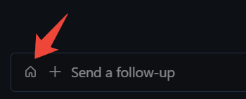
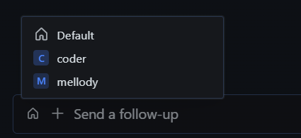
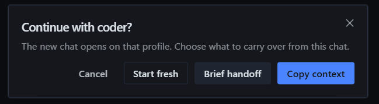

# Hermes Profile Switcher

A compact profile picker and context handoff control for [Hermes Desktop](https://github.com/NousResearch/hermes-agent).

Open a new chat with another profile, choose how much context to carry, and keep the current project when both profiles share a verified project folder on the same gateway.

## Features

- **Focused-chat owner indicator** next to the composer's `+`: home icon for the default profile, initial using the SDK's native profile colors for a named profile, neutral indicator when ownership or color helpers are unavailable.
- **Profile menu** using Hermes' native UI components and full connection-qualified routes.
- **Three choices** when switching from a stored chat to a different profile:

  | Action | New chat |
  | --- | --- |
  | **Copy context** | Up to the last 20 visible text turns, with source attribution and an explicit truncation notice when capped. |
  | **Brief handoff** | A short, locally assembled extractive brief; no model call. |
  | **Start fresh** | An empty session on the selected profile. |

- **Project inheritance** for supported, verified single-folder projects on the same gateway, including automatic folder groups and an empty target profile project.
- **Confirmed no-project (Home) chats and live empty drafts** are valid contexts: open on the selected profile without inventing a project or carrying nonexistent content.
- **Cancel / Escape** create nothing. The source session is never modified.
- **Failure recovery** offers an explicit action to reopen a known created chat without creating another. Recovery handles last only while that control remains mounted.

This plugin opens **new sessions**. It does not change an existing chat's owner, insert a guest reply, send a message automatically, or transfer composer drafts or attachments.

## Screenshots

**Open the profile picker from the composer.**



**Choose the target profile.**



**Choose what to carry into the new chat.**



## Compatibility

Initial version: **0.1.0** in `plugin.yaml`.

Supported Hermes floor: **0.22.2 or newer**, declared in the manifest. This is a conservative support boundary for the checked SDK generation, not a claim that every older build lacks these APIs or that every newer build/platform has been UI-tested.

Target checked: **Hermes Desktop v0.22.2**, client source commit `8b66a51036c1e20920a17cdd049fdf55c968d683`. The Windows tester reported successful checks of the three choices, project inheritance, cancellation and preservation of the source chat after the project-lane fix. This is a user-reported acceptance result, not an automated Electron certification or a claim of compatibility with every build or operating system.

The plugin uses only public `@hermes/plugin-sdk`, React and JSX-runtime imports. No build step, bundled dependencies, Python backend or install scripts are required. SDK availability is checked at runtime; unsupported builds may offer only plain new-chat behavior or show an unavailable notice. Creating a handoff requires browser Web Crypto; without it the operation is refused rather than using a predictable key. See [usage and compatibility limits](docs/USAGE.md).

The tester subsequently reported the updated plugin working in smoke tests. The consolidated catalog candidate has independent source/SDK-double coverage for hardening, no-project/empty-source handling and native icon colors; its installed Windows digest was not independently retrieved. This remains an **experimental community plugin**, not certification of every build, platform or gateway topology.

## Install

**Install from Git.** Settings → Plugins → **Install from Git**, and use the identifier:

```text
Vsemagush/hermes-profile-switcher
```

Review the installation prompt, then enable **Hermes Profile Switcher** in Desktop plugin settings if it is not already enabled. No API key, `npm install` or gateway restart is needed.

**One-click link.** The `repo` probe shows what will be installed before anything is written:

```html
<a href="hermes://plugin/install?repo=Vsemagush/hermes-profile-switcher&enable=1">Install in Hermes</a>
```

The same target as a plain URL, for pasting into the app or a message:

```text
hermes://plugin/install?repo=Vsemagush/hermes-profile-switcher&enable=1
```

**By hand.** Copy `desktop/plugin.js` into the app-level desktop plugins directory as:

```text
$HERMES_HOME/desktop-plugins/hermes-profile-switcher/plugin.js
```

Use **Open folder** in the Desktop plugin settings to find the actual app-level directory (`~/.hermes/desktop-plugins/...` by default). The subfolder must match the plugin id, **`hermes-profile-switcher`**. With a remote gateway, install the UI file on the Desktop machine, not just on the server. Do not copy the whole repository into the loaded plugin directory.

The app hot-loads the file and later saves. If needed, run **Reload desktop plugins** from the command palette.

The plugin is being prepared for the curated catalog; it is not listed there yet. Use the Git identifier above, not a catalog-name install command.

### Update, disable or remove

- **Update:** keep a backup of the old file outside the loaded plugins directory, then replace only this plugin's `plugin.js`.
- **Disable:** turn off **Hermes Profile Switcher** in Desktop plugin settings.
- **Remove:** disable it and remove only the `hermes-profile-switcher` subfolder.
- **Roll back:** restore the backed-up file and reload plugins if necessary.

Disabling or removing the plugin does **not** remove chats already created by it. The plugin does not automatically delete sessions to undo a handoff.

## Privacy and limits

- Copying context intentionally stores selected source text in a **new session on the target profile/gateway**. Its subsequent model requests may include that text and consume the target profile's context budget. Review your source and target before choosing a context option.
- The plugin reads focused session/project metadata. When a source is absent from the bounded persisted list, it may also read the live session roster and source transcript to verify emptiness, including for **Start fresh** or choosing the current profile. It does not seed that transcript unless a context-carrying option is chosen.
- `Copy context` is capped at **20 visible messages / 12,000 characters**. Hidden, system and tool rows are excluded. Recognisable media directives, data URIs and typed media parts are filtered. `Brief handoff` uses up to **6 excerpts of 240 characters**; it is not an AI-generated summary.
- **Media filtering is best-effort, not a guarantee.** A gateway can flatten an attachment into an untyped HTTP URL indistinguishable from an authored link. Ordinary URLs are preserved, including standalone image-file links: they may still point to an attachment or cause the host to recognise media. The plugin does not infer media provenance from a filename suffix. An unpadded data-URI payload glued directly to a caption can also lose that caption when it consists only of base64-alphabet characters, while a payload without a recognisable end boundary is kept as text. Neither case is fully resolvable from the flattened history; review copied context when that distinction matters.
- On a **different gateway or mode**, no project folder is inherited. The new session is created without an explicit inherited folder and a notice explains the limitation. Source folders are not copied or made accessible on another host. A brief may still include the source folder name as text; that does not grant filesystem access.
- Ambiguous, multi-folder, worktree or conflicting project structures are refused rather than guessed. Session lookup is bounded to 200 rows. A source outside that window is refused unless strict live identity/idle/empty fields and a transcript reporting zero messages independently agree that it is empty; a hydrating saved chat's live row alone is not proof.
- An unpersisted draft's project folder is unavailable through these public projections, so the new chat opens **without inherited project context**. Choose the project explicitly afterward. For a different profile the choice dialog still appears: **Copy context** and **Brief handoff** explain that nothing was carried; no fake seed or title write is used on this plain-new-chat path. An unavailable or disagreeing emptiness check refuses the operation.
- The plugin registers no keyboard shortcut; native Ctrl+N belongs to Hermes.
- The icon reflects the **globally focused chat**, not the independent owner of every split composer. Visual placement uses the plugin's own CSS and is build-dependent; visual order does not change keyboard tab order.
- Source-drift guards prevent subsequent plugin calls, but cannot cancel an `openSession` call already accepted by the host. That host operation may finish its dial/navigation after you change focus.
- A create can succeed even if opening or confirming it fails. When its IDs are known, use **Open created chat with …** to retry opening that exact chat: route and durable identity are checked again, without another create/title/history transfer. Recovery is mount-local and disappears on unload/reload; an unmaterialised empty session cannot be reopened until a durable row exists. Unknown outcomes still require checking the target session list before another create. No automatic rollback is promised.
- Technical route names are used; custom roster display names are not fetched.

## Development

Use Node.js and npm. The checks were run with Node **v26.7.0** and npm **12.0.2**; older Node releases are not certified here. No third-party npm dependencies are needed.

```sh
npm test
npm run check
```

The current suite has **462 passing tests** covering the real plugin entry loaded through SDK/React doubles, Home/no-project and two-door empty-source checks, native profile-color delegation and named-glyph geometry, pre-create route freshness, abandoned-action cancellation, documented media-filtering limits and metadata contracts. These tests do not run Electron, a live model or the Windows UI. If a Hermes CLI is available, run the catalog admission check with `hermes plugins validate . --install-deps --json`.

See [CONTRIBUTING.md](CONTRIBUTING.md) for contribution boundaries and [CHANGELOG.md](CHANGELOG.md) for the initial feature set.

## License

MIT — see [LICENSE](LICENSE).

Hermes, its SDK and React are supplied by the host application and retain their respective licenses. They are not vendored into this repository. This is an independent plugin, not an official Nous Research release.
